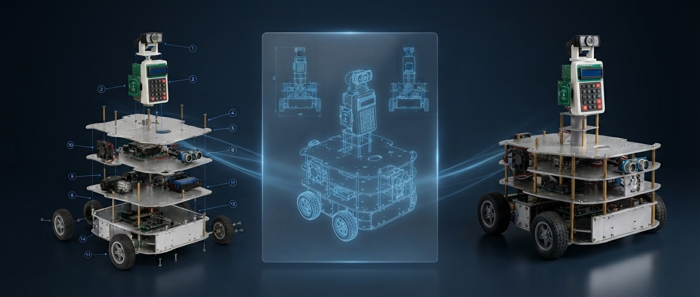
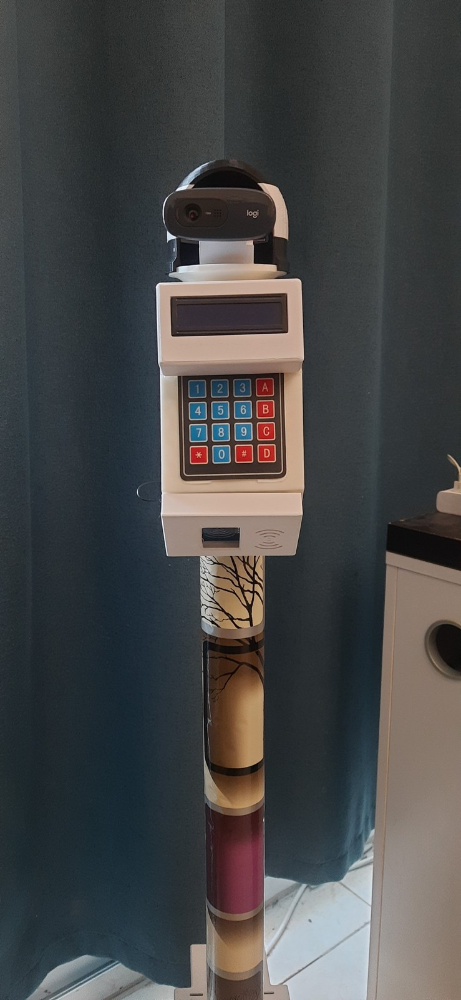
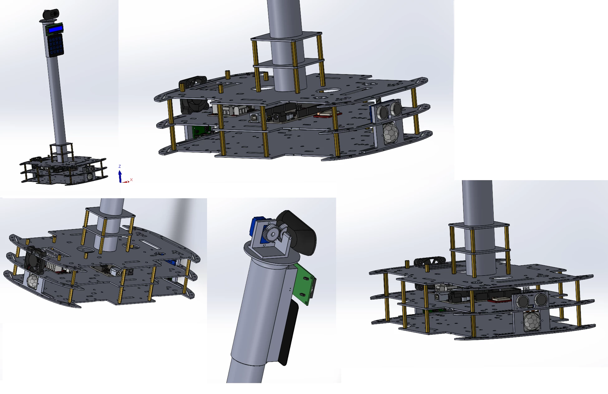

# CARA — Companion Assistive Robot for the Aged

> **Status: research prototype (v1.0) — source code is private.**
> This repository is a public showcase only. It contains no source code, firmware, models or configuration files.

  

CARA is a low-cost mobile companion robot for older adults who live alone, built as an MSc Robotics dissertation project at Middlesex University Dubai. It moves around the home on its own, watches for falls with a camera and AI pose estimation, reminds the user to take medication, and sends SMS alerts to family over the cellular network, so its safety functions keep working without Wi-Fi or internet access. The full thesis title is *"A Low-Cost GSM-Based Companion Assistive Robot for Elderly Care and Human-Robot Interaction in Developing Countries."*

## The problem

Sri Lanka's elderly population is growing faster than its care infrastructure. The share of people aged 60 and over is projected to reach one in four by 2041. Many working-age adults have migrated abroad for work, so many elderly parents now live alone, often in rural or semi-urban areas where professional care is scarce and internet access is unreliable or missing. The main risks are falls that nobody notices, missed medication, slow emergency response and social isolation.

Existing assistive and companion robots cost between $5,000 and $100,000, need a continuous Wi-Fi connection, and were designed for high-income settings. CARA asks whether one platform costing under $500 can meet the main safety and companionship needs of a person living alone, without relying on Wi-Fi and without asking the elderly user to do anything.

## Design principles

- **Low cost.** The total bill of materials is under $500.
- **No Wi-Fi dependency for safety.** Safety-critical alerts go over GSM/LTE cellular SMS.
- **No required interaction.** CARA monitors and alerts on its own. The user does not need to press buttons, give voice commands or understand the system.

## Key capabilities

- **AI-based fall detection.** A camera and body-pose estimation detect falls, with no wearable device needed.
- **GSM/LTE SMS alerts.** Family members get a text message when a fall is confirmed, with no Wi-Fi or internet needed.
- **Obstacle avoidance.** A 360° ring of ultrasonic sensors stops the robot before it hits anything.
- **Person following.** The robot keeps track of its registered user as they move around the home.
- **Medication reminders.** At scheduled times the robot sounds an audible reminder and shows an on-screen message, and the user acknowledges it on a keypad.
- **Daily check-in SMS.** A daily status message tells family that CARA is online and has seen the user recently.
- **Phone-browser access.** Family can view a live camera feed and drive the robot remotely from a phone browser on the home network, with no app to install.
- **Companion behaviours.** The robot greets people with time-appropriate messages, a chime and a wave gesture.

CARA v1.0 is specified against **15 features** in three priority tiers: critical, high and medium. A few planned features were deferred to later versions.

## Headline results

| | |
|---|---|
| Prototype hardware cost | **$409.10**, below the $500 target (market-rate estimate) |
| Wi-Fi connections required for safety functions | **0** |
| Integrated features evaluated | **15**, tested in a controlled laboratory setting |
| Project milestone | v1.0 development complete, thesis submitted and defended (2026) |

Evaluation targets set by the research objectives include at least 80% fall-detection accuracy across 20 standardised trials and fall-alert SMS delivery within 30 seconds. See the [project website](https://jayashankaanushan19.github.io/CARA/) for the full objectives and evaluation context.

CARA v1.0 is a research prototype, **not a clinical or commercial product**. Using it in real homes would first require further safety validation, longer trials with elderly participants, and review against the relevant personal-care robot safety standards.

## Gallery

| Assembled head unit | CAD prototype |
|---|---|
|  |  |

There is a short, high-level system overview in [docs/overview.md](docs/overview.md).

## Links

- Project website: <https://jayashankaanushan19.github.io/CARA/>
- Development blog: <https://jayashankaanushan19.github.io/CARA/blog/>
- Author portfolio: <https://jayashankaanushan19.github.io/>

## Code access

The implementation is kept in a **private repository** and is not published here. Researchers and examiners who need access can send a request through the project contact page:
<https://jayashankaanushan19.github.io/CARA/contact.html>

## Author

**Jayashanka Anushan**
MSc Robotics, Middlesex University Dubai, 2026

## License

Copyright © 2026 Jayashanka Anushan. All rights reserved. See [LICENSE](LICENSE).
